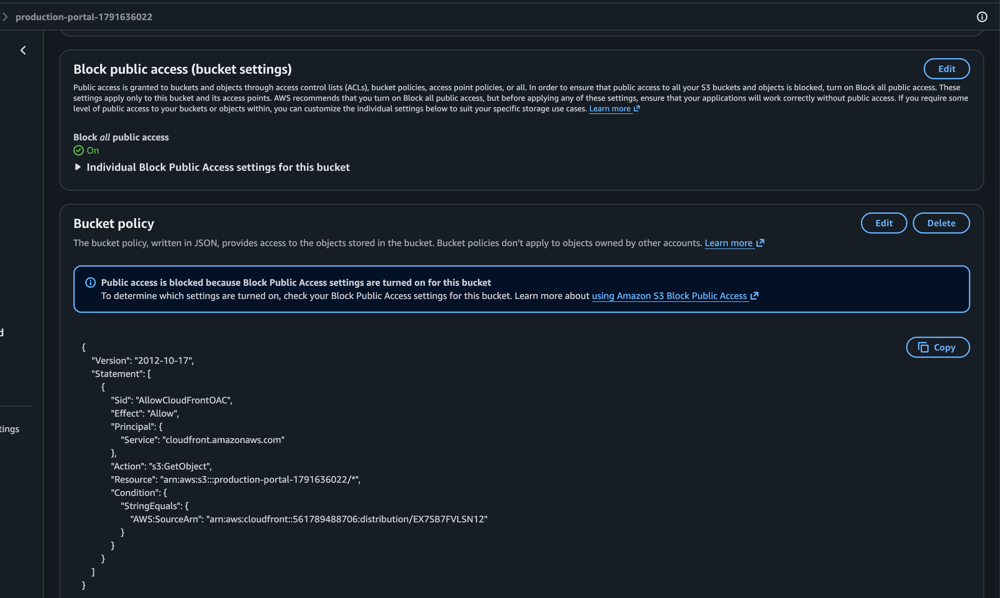
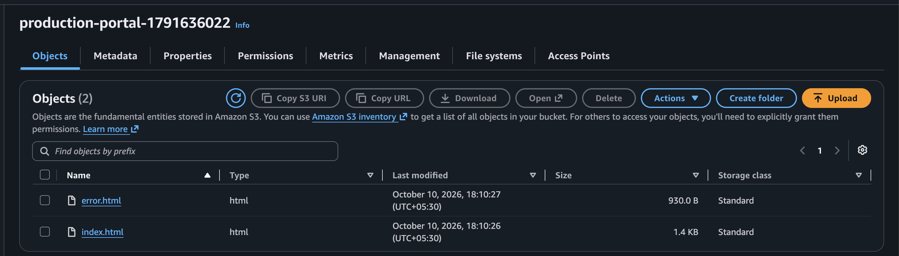
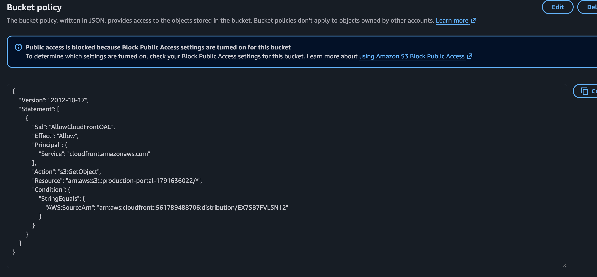
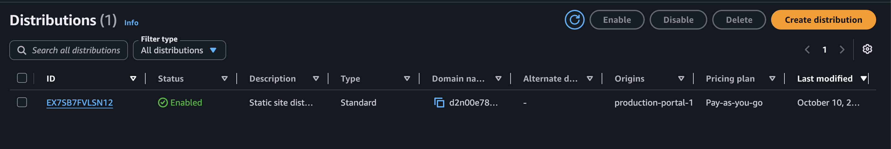
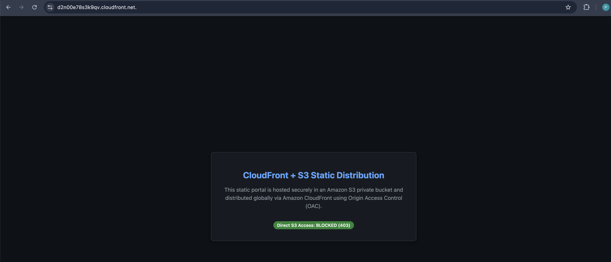
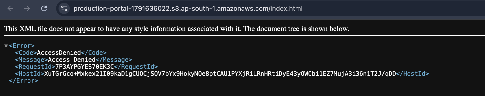
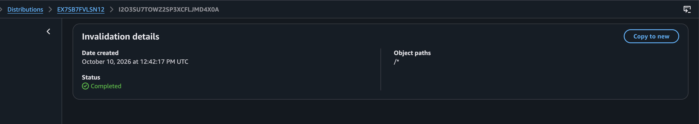

# Task-2: CloudFront + S3 Static Website

## 📖 Architecture Overview
This task demonstrates a highly secure, serverless presentation tier. We hosted a static website (`index.html` and `error.html`) in an Amazon S3 bucket and distributed it globally using Amazon CloudFront.

**Key Security Implementations:**
* **Direct Access Blocked:** The S3 bucket strictly blocks all public access. The only entity capable of reading the bucket objects is the CloudFront Distribution.
* **Origin Access Control (OAC):** We implemented the modern OAC standard (which supersedes the legacy Origin Access Identity) to sign requests between CloudFront and S3 via AWS SigV4.
* **Custom Error Routing:** Any 403 (Forbidden) or 404 (Not Found) errors returned by S3 are seamlessly caught by CloudFront and routed to a custom `/error.html` page.
* **Edge Caching & Invalidation:** Content is cached at edge locations globally to reduce latency, and automated invalidation commands are utilized to flush stale caches when new deployments occur.

## 📂 Project File Structure
This module is organized to separate automation logic, security policies, and the static website assets:

```text
Task-2-CloudFront/
├── scripts/
│   └── cloudfront-setup.sh    # Core bash automation script provisioning S3, OAC, and CloudFront
├── static/
│   ├── index.html             # The main static UI portal
│   └── error.html             # Custom 404/403 error page routed by CloudFront
├── policy/
│   └── s3-oac-policy.json     # Reference S3 Bucket policy enforcing Origin Access Control
├── screenshots/               # Proof of execution captures
└── README.md                  # Task documentation
```

## 🤖 Automation via Bash Script
To ensure repeatable and error-free infrastructure provisioning, the entire deployment was codified into a single bash script: `scripts/cloudfront-setup.sh`. 

When executed, this script autonomously:
1. Dynamically fetches the active AWS Account ID to build strict security policies.
2. Creates the private S3 bucket and permanently blocks all public access.
3. Uploads the HTML files from the `static/` directory.
4. Generates an Origin Access Control (OAC) signature.
5. Deploys the global CloudFront Distribution with custom error routing.
6. Attaches the strict bucket policy to S3 to allow read access *only* from the CloudFront Distribution.

## 🚀 Execution Guide & Commands Log

This entire infrastructure was provisioned autonomously using our `scripts/cloudfront-setup.sh` bash script. Below are the core AWS CLI commands that were executed under the hood:

### 1. Provision the Private S3 Bucket
```bash
aws s3api create-bucket --bucket production-portal-1791636022 --region ap-south-1 --create-bucket-configuration LocationConstraint=ap-south-1

# Apply strict public access blocks
aws s3api put-public-access-block --bucket production-portal-1791636022 --public-access-block-configuration BlockPublicAcls=true,IgnorePublicAcls=true,BlockPublicPolicy=true,RestrictPublicBuckets=true

# Upload assets
aws s3 cp static/index.html s3://production-portal-1791636022/index.html
aws s3 cp static/error.html s3://production-portal-1791636022/error.html
```

### 2. Configure Origin Access Control (OAC)
```bash
aws cloudfront create-origin-access-control \
  --origin-access-control-config Name=MyOAC,OriginAccessControlOriginType=s3,SigningBehavior=always,SigningProtocol=sigv4,Description="OAC for static site"
```

### 3. Deploy CloudFront Distribution
```bash
aws cloudfront create-distribution --distribution-config file://config.json
```
*(The configuration JSON dynamically mapped the OAC to the S3 Origin and configured the DefaultCacheBehavior).*

### 4. Apply the OAC Bucket Policy
```bash
aws s3api put-bucket-policy --bucket production-portal-1791636022 --policy file://policy/s3-oac-policy.json
```
*(This policy strictly enforces that `aws:SourceArn` matches the CloudFront distribution).*

### 5. Execute Cache Invalidation
```bash
aws cloudfront create-invalidation --distribution-id EX7SB7FVLSN12 --paths "/*"
```

---

## 📸 Execution Screenshots

### 1. S3 Public Access Blocked
All 4 public access blocks are permanently enabled on the bucket.


### 2. S3 Objects Uploaded
The static assets (`index.html`, `error.html`) uploaded to the private bucket.


### 3. S3 Bucket Policy (OAC Enforcement)
The bucket policy strictly allowing only the CloudFront distribution ARN.


### 4. CloudFront Distribution Status
The active distribution pointing to the S3 origin.


### 5. CloudFront Live URL (HTTPS)
The static portal loading successfully via the global CDN URL.


### 6. S3 Direct Access Blocked (403)
Attempting to hit the S3 bucket URL directly yields an `AccessDenied` error, validating the security boundary.


### 7. Cache Invalidation
The completed `/*` cache invalidation request.


## 🧹 Environment Cleanup

To prevent unnecessary AWS charges after validating the deployment, follow these steps to destroy the Task 2 infrastructure.

### 1. Delete the S3 Bucket
Since the bucket contains objects (`index.html`, `error.html`), use the `--force` flag to automatically empty and delete it in one command:
```bash
aws s3 rb s3://production-portal-1791636022 --force
```

### 2. Disable and Delete CloudFront
*Note: A CloudFront distribution MUST be disabled before it can be deleted.*
*   **Easiest Method (AWS Console):** Go to the CloudFront Dashboard, select the distribution (`EX7SB7FVLSN12`), and click **Disable**. Wait approximately 3 minutes for it to finish deploying, and then click **Delete**.
*   **CLI Method:**
    ```bash
    # 1. Get the ETag (required for updates)
    ETAG=$(aws cloudfront get-distribution-config --id EX7SB7FVLSN12 --query 'ETag' --output text)
    
    # 2. Extract config, change "Enabled": true to false, and update
    aws cloudfront get-distribution-config --id EX7SB7FVLSN12 --query 'DistributionConfig' --output json | sed 's/"Enabled": true/"Enabled": false/' > disabled-config.json
    aws cloudfront update-distribution --id EX7SB7FVLSN12 --if-match $ETAG --distribution-config file://disabled-config.json
    
    # 3. Wait 3 minutes, fetch the NEW ETag, and delete
    NEW_ETAG=$(aws cloudfront get-distribution-config --id EX7SB7FVLSN12 --query 'ETag' --output text)
    aws cloudfront delete-distribution --id EX7SB7FVLSN12 --if-match $NEW_ETAG
    ```

### 3. Delete the Origin Access Control (OAC)
*Note: The CloudFront distribution must be completely deleted before AWS allows you to delete the OAC.*
```bash
# 1. Fetch the ETag for the OAC
OAC_ETAG=$(aws cloudfront get-origin-access-control --id E1M1DW696YS0S6 --query 'ETag' --output text)

# 2. Delete the OAC
aws cloudfront delete-origin-access-control --id E1M1DW696YS0S6 --if-match $OAC_ETAG
```
