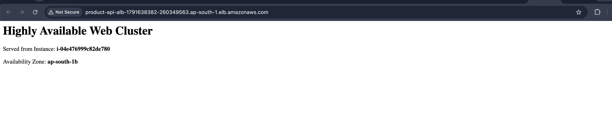

# Task-3: ASG + ALB + Auto Scaling

## 📖 Architecture Overview
This task demonstrates a highly available, self-healing Application Tier using EC2 Virtual Machines. 
Traffic is distributed across multiple Availability Zones using an **Application Load Balancer (ALB)**, while an **Auto Scaling Group (ASG)** ensures the cluster dynamically scales out under high CPU load and automatically replaces failed instances.

**Key Implementations:**
* **Launch Template:** Bootstraps Amazon Linux 2023 instances with an Apache web server that dynamically outputs its Instance ID and Availability Zone to prove Load Balancing.
* **Security Groups:** The EC2 instances are strictly isolated and only accept port 80 traffic originating from the ALB Security Group.
* **Dynamic Auto Scaling:** A Target Tracking Policy scales the ASG out if the average CPU utilization exceeds 70%.
* **Self-Healing:** The ASG is tied to the ALB's health checks. If an instance fails or is terminated, it is automatically detected and replaced to maintain the Desired Capacity.

## 🚀 Execution Guide & Commands Log

This entire infrastructure was provisioned autonomously using our `scripts/asg-alb-setup.sh` script.

### 1. Provision Security Groups & Rules
```bash
# ALB Security Group (Internet Facing)
aws ec2 create-security-group --group-name alb-sg --description "Allow HTTP from internet"
aws ec2 authorize-security-group-ingress --group-id sg-alb --protocol tcp --port 80 --cidr 0.0.0.0/0

# EC2 Security Group (Isolated)
aws ec2 create-security-group --group-name ec2-asg-sg --description "Allow HTTP only from ALB"
aws ec2 authorize-security-group-ingress --group-id sg-ec2 --protocol tcp --port 80 --source-group sg-alb
```

### 2. Create Launch Template & Target Group
```bash
# Fetches latest AL2023 AMI dynamically via SSM
aws ec2 create-launch-template --launch-template-name product-api-lt --launch-template-data file://config.json
aws elbv2 create-target-group --name product-api-tg --protocol HTTP --port 80 --health-check-path "/"
```

### 3. Deploy Application Load Balancer
```bash
aws elbv2 create-load-balancer --name product-api-alb --subnets subnet-1 subnet-2 --security-groups sg-alb
aws elbv2 create-listener --load-balancer-arn arn:aws... --protocol HTTP --port 80 --default-actions Type=forward,TargetGroupArn=arn:aws...
```

### 4. Deploy Auto Scaling Group & Policy
```bash
aws autoscaling create-auto-scaling-group \
  --auto-scaling-group-name product-api-asg \
  --launch-template LaunchTemplateId=lt-123,Version=$Latest \
  --min-size 1 --max-size 4 --desired-capacity 2 \
  --vpc-zone-identifier "subnet-1,subnet-2" \
  --target-group-arns arn:aws... \
  --health-check-type ELB --health-check-grace-period 60

aws autoscaling put-scaling-policy \
  --auto-scaling-group-name product-api-asg \
  --policy-name scale-out-cpu-70 \
  --policy-type TargetTrackingScaling \
  --target-tracking-configuration '{"PredefinedMetricSpecification": {"PredefinedMetricType": "ASGAverageCPUUtilization"}, "TargetValue": 70.0}'
```

---

## 📸 Execution Screenshots

### 1. Load Balancer Distributing Traffic
The ALB successfully routing traffic to the EC2 instances across different AZs.


### 2. CPU Auto Scaling Policy
The Target Tracking scaling policy configured to trigger when CPU > 70%.


### 3. Unhealthy Instance Replacement (Self-Healing)
Proof of the ASG automatically detecting a terminated instance and successfully launching a replacement.


## 🧹 Environment Cleanup

To prevent ongoing EC2 instance and Load Balancer hourly charges, destroy the infrastructure using the AWS Console:

### 1. Delete the Auto Scaling Group
1. Navigate to **EC2 -> Auto Scaling Groups**.
2. Select the `product-api-asg-*` group.
3. Click **Delete**. *(This will automatically terminate the running EC2 instances).*

### 2. Delete the Application Load Balancer
1. Navigate to **EC2 -> Load Balancers**.
2. Select the `product-api-alb-*` balancer.
3. Click **Actions -> Delete**.

### 3. Delete the Target Group
1. Navigate to **EC2 -> Target Groups**.
2. Select the `product-api-tg-*` group.
3. Click **Actions -> Delete**.

### 4. Delete the Launch Template
1. Navigate to **EC2 -> Launch Templates**.
2. Select `product-api-lt-*`.
3. Click **Actions -> Delete template**.
