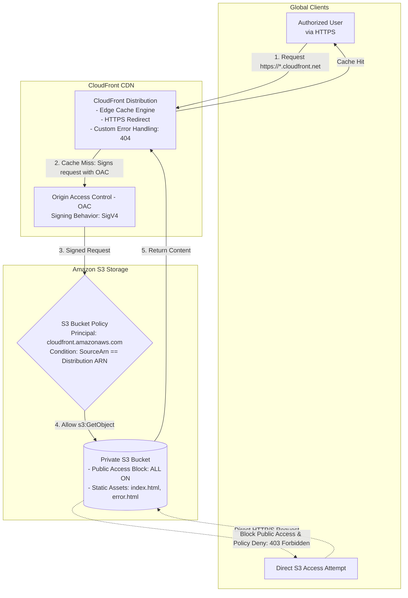

# Task 2: Secure Static Website Hosting via CloudFront & S3 (OAC Restricted)

## Overview
This task demonstrates configuring a secure, high-performance static website distribution using Amazon CloudFront and Amazon S3. Direct public access to the S3 bucket is strictly blocked. Access is restricted exclusively to CloudFront edge locations using modern **Origin Access Control (OAC)** with AWS SigV4 request signing. In addition, automated cache invalidation is implemented to push content updates to edge locations without cache latency.

---

## Architecture Diagram



---

## Repository & Component Layout

```
task-2/
├── scripts/
│   └── cloudfront-setup.sh      # Automated provisioning script (S3 + OAC + CDN + Policy)
├── static/
│   ├── index.html               # Static website portal home page
│   └── error.html               # Custom 404 error response page
├── policy/
│   └── s3-oac-policy.json       # IAM bucket policy template for CloudFront OAC
├── screenshots/                 # Submission proof screenshots
│   ├── cf-01-bucket-created.png
│   ├── cf-02-files-uploaded.png
│   ├── cf-03-bucket-policy.png
│   ├── cf-04-distribution-deployed.png
│   ├── cf-05-site-loads-via-cdn.png
│   ├── cf-06-direct-s3-blocked.png
│   └── cf-07-cache-invalidation.png
└── README.md
```

---

## Key Configurations

| Component | Configuration Value | Security Purpose |
|---|---|---|
| S3 Public Access | All 4 block settings = `true` | Prevents any public object or bucket URL access |
| Origin Authentication | CloudFront Origin Access Control (OAC) | Replaces legacy OAI; signs requests with SigV4 |
| S3 Bucket Policy | `s3:GetObject` with `AWS:SourceArn` condition | Guarantees only this specific CloudFront distribution can read files |
| Viewer Protocol | `redirect-to-https` | Enforces TLS encrypted in-transit communication |
| Cache Policy | AWS Managed CachingOptimized (`658327ea-...`) | Standard TTL caching for production static websites |
| Custom Error Pages | `404` mapped to `/error.html` with TTL 10s | Prevents exposing raw S3 XML errors to end-users |

---

## Implementation Steps

### 1. Automated Provisioning
The provisioning script handles bucket creation, object upload, OAC creation, CloudFront distribution launch, and S3 policy attachment:

```bash
chmod +x task-2/scripts/cloudfront-setup.sh
bash task-2/scripts/cloudfront-setup.sh
```

### 2. Manual Step-by-Step Breakdown

If provisioning via AWS CLI or AWS Management Console manually:

1. **Create Private S3 Bucket**:
   ```bash
   aws s3api create-bucket \
     --bucket my-secure-static-site-prod \
     --region ap-south-1 \
     --create-bucket-configuration LocationConstraint=ap-south-1
   ```

2. **Enable Block Public Access**:
   ```bash
   aws s3api put-public-access-block \
     --bucket my-secure-static-site-prod \
     --public-access-block-configuration \
       BlockPublicAcls=true,IgnorePublicAcls=true,BlockPublicPolicy=true,RestrictPublicBuckets=true
   ```

3. **Upload Static Assets**:
   ```bash
   aws s3 cp task-2/static/index.html s3://my-secure-static-site-prod/index.html
   aws s3 cp task-2/static/error.html s3://my-secure-static-site-prod/error.html
   ```

4. **Create CloudFront Origin Access Control (OAC)**:
   ```bash
   aws cloudfront create-origin-access-control \
     --origin-access-control-config \
       Name=StaticSiteOAC,OriginAccessControlOriginType=s3,SigningBehavior=always,SigningProtocol=sigv4,Description="OAC for S3 static site"
   ```

5. **Attach Bucket Policy (Restrict Direct S3 Access)**:
   Update `task-2/policy/s3-oac-policy.json` with your Bucket Name, AWS Account ID, and CloudFront Distribution ID, then run:
   ```bash
   aws s3api put-bucket-policy \
     --bucket my-secure-static-site-prod \
     --policy file://task-2/policy/s3-oac-policy.json
   ```

---

## Cache Invalidation Workflow

When web assets are updated in S3, CloudFront edge caches will continue serving cached versions until their TTL expires unless an invalidation is issued.

### Invalidate Entire Website:
```bash
aws cloudfront create-invalidation \
  --distribution-id <DISTRIBUTION_ID> \
  --paths "/*"
```

### Invalidate Specific Assets:
```bash
aws cloudfront create-invalidation \
  --distribution-id <DISTRIBUTION_ID> \
  --paths "/index.html" "/error.html"
```

### Verify Invalidation Progress:
```bash
aws cloudfront list-invalidations --distribution-id <DISTRIBUTION_ID>
```

---

## Verification & Security Testing

1. **Verify CloudFront Delivery (HTTPS)**:
   ```bash
   curl -I https://<distribution-domain>.cloudfront.net/
   # Expected HTTP Status: 200 OK (Served via CloudFront)
   ```

2. **Verify Direct S3 Access is Blocked**:
   ```bash
   curl -I https://my-secure-static-site-prod.s3.ap-south-1.amazonaws.com/index.html
   # Expected HTTP Status: 403 Forbidden
   ```

---

## Proof of Submission & Screenshots

All execution proofs are preserved in the [`screenshots/`](screenshots/) directory.

### 1. Private S3 Bucket with Public Access Block
Shows S3 bucket created with all 4 Block Public Access settings enabled.

*File: `screenshots/cf-01-bucket-created.png`*

---

### 2. Static Website Assets Uploaded
AWS S3 Console object listing showing `index.html` and `error.html`.

*File: `screenshots/cf-02-files-uploaded.png`*

---

### 3. S3 Bucket Policy Enforcing OAC Access
S3 permissions tab displaying the bucket policy restricting access to `AWS:SourceArn` of CloudFront.

*File: `screenshots/cf-03-bucket-policy.png`*

---

### 4. CloudFront Distribution Active
AWS CloudFront console confirming status `Deployed` / `Enabled` with Origin pointing to S3 via OAC.

*File: `screenshots/cf-04-distribution-deployed.png`*

---

### 5. Website Loaded Securely via CloudFront Domain
Browser screenshot accessing `https://*.cloudfront.net` rendering the web page with valid SSL/TLS certificate.

*File: `screenshots/cf-05-site-loads-via-cdn.png`*

---

### 6. Direct S3 Access Blocked (HTTP 403 Forbidden)
Browser or terminal showing `403 Access Denied` when attempting to access the direct S3 URL.

*File: `screenshots/cf-06-direct-s3-blocked.png`*

---

### 7. Cache Invalidation Executed
CLI or console output confirming invalidation request with status `Completed`.

*File: `screenshots/cf-07-cache-invalidation.png`*
