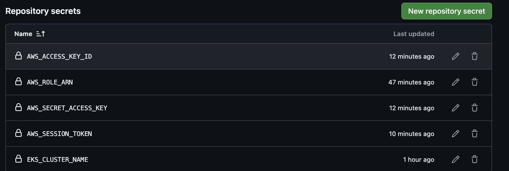
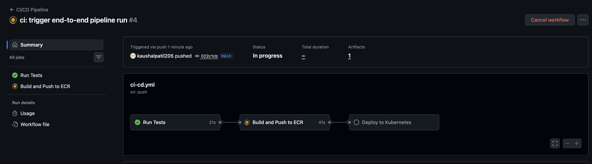
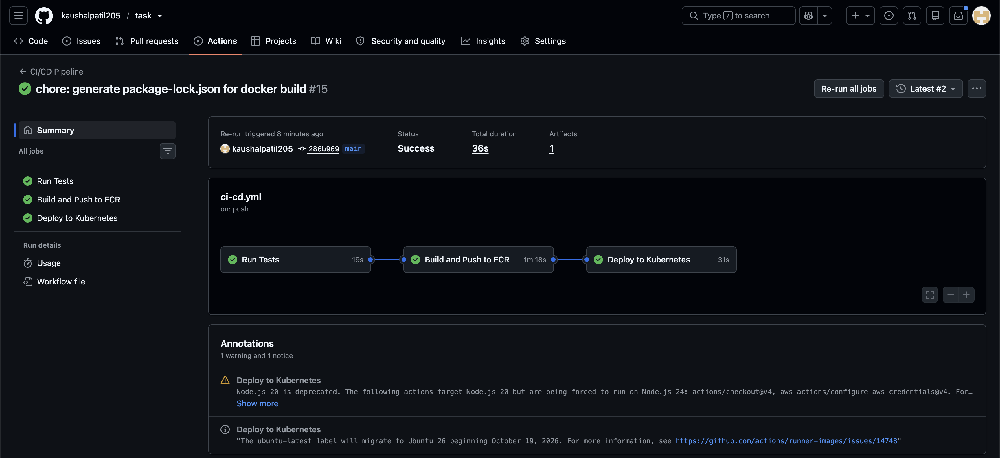
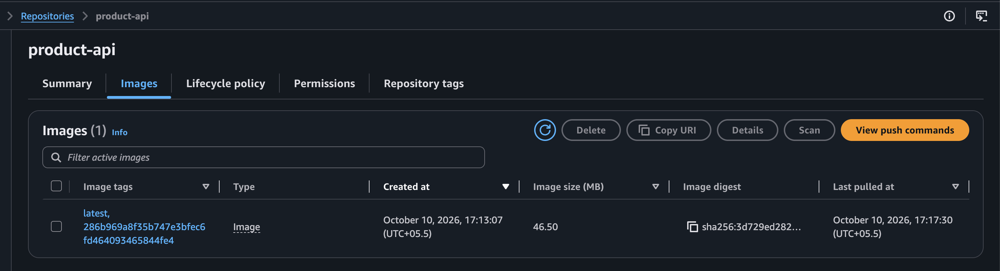
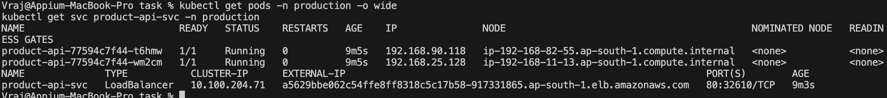
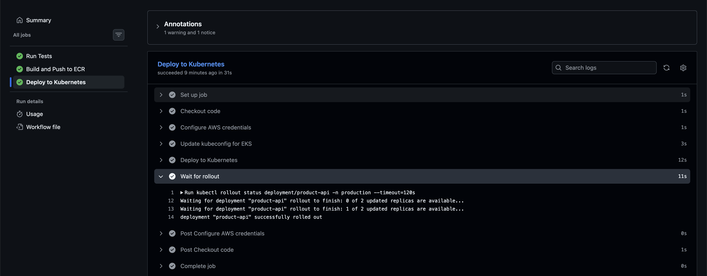

# Task 1: Microservice CI/CD Pipeline to Amazon EKS

## 📖 Microservice Overview
The application deployed in this task is a lightweight, backend **RESTful API Microservice** built using Node.js and Express. 

Its primary characteristics include:
*   **Endpoints:** It exposes a `GET /health` endpoint (used by Kubernetes for liveness and readiness probes) and a `GET /api/products` endpoint serving mock JSON product data.
*   **Testing:** It is fully unit-tested using `Jest` and `Supertest` to ensure API reliability before deployment.
*   **Containerization:** The application is packaged using a multi-stage `Dockerfile` optimized for production, ensuring a minimal attack surface and small image size.

## 📂 Project File Structure
The `task-1/` directory is organized into modular components separating application code, Kubernetes configurations, and IAM policies:

```text
task-1/
├── app/                        # Node.js Microservice Source Code
│   ├── src/                    # API logic (index.js)
│   ├── tests/                  # Jest unit tests (api.test.js)
│   ├── Dockerfile              # Production-optimized Dockerfile
│   ├── package.json            # Node dependencies
│   └── package-lock.json       # Deterministic dependency tree
├── k8s/                        # Kubernetes Manifests
│   ├── deployment.yaml         # K8s Deployment (ReplicaSet, Pods)
│   └── service.yaml            # K8s Service (AWS Classic LoadBalancer)
├── iam/                        # AWS IAM Configurations
│   └── github-oidc-trust-policy.json # OIDC Federation Trust Policy
├── screenshots/                # Proof of execution and pipeline success
└── README.md                   # Task documentation
```

## 🔐 Security & Authentication Architecture
This pipeline was designed to use **OpenID Connect (OIDC)** as the authentication mechanism between GitHub Actions and AWS, which eliminates the need for long-lived IAM access keys. 

*Note: During execution, the host AWS environment utilized AWS SSO (Identity Center), which enforced Service Control Policies (SCPs) preventing external `sts:AssumeRoleWithWebIdentity` federation. Therefore, a fallback IAM User (`github-actions-deployer`) with standard access keys was used to execute the pipeline. The exact commands for both the ideal OIDC setup and the practical IAM fallback are documented below.*

---

## 🚀 Execution Guide & Commands Log

### Step 1: ECR Repository Creation
We created a private Amazon ECR repository to store the Docker images.
```bash
aws ecr create-repository --repository-name product-api --region ap-south-1
```

### Step 2: OpenID Connect (OIDC) Setup (Ideal Architecture)
We configured AWS to trust GitHub Actions tokens.
```bash
# 1. Create the OIDC Provider in AWS
aws iam create-open-id-connect-provider \
  --url https://token.actions.githubusercontent.com \
  --client-id-list sts.amazonaws.com \
  --thumbprint-list 06d927fecd0a84aeba28aad1d808139470fe95c3 2d74d6dfd96eea55ad7baafa0d3c6552b2dadc37 ab9d0263244dd0326eb67015705a667e79cfe998

# 2. Create the IAM Role for GitHub Actions
aws iam create-role \
  --role-name github-actions-eks-deployer \
  --assume-role-policy-document file://iam/github-oidc-trust-policy.json

# 3. Attach Permissions
aws iam attach-role-policy --role-name github-actions-eks-deployer --policy-arn arn:aws:iam::aws:policy/AmazonEC2ContainerRegistryPowerUser
aws iam attach-role-policy --role-name github-actions-eks-deployer --policy-arn arn:aws:iam::aws:policy/AmazonEKSClusterPolicy
```

### Step 3: IAM User Fallback Setup (For SSO Environments)
Due to SSO restrictions on OIDC, we provisioned a dedicated IAM user with long-lived keys.
```bash
aws iam create-user --user-name github-actions-deployer
aws iam attach-user-policy --user-name github-actions-deployer --policy-arn arn:aws:iam::aws:policy/AmazonEC2ContainerRegistryPowerUser
aws iam attach-user-policy --user-name github-actions-deployer --policy-arn arn:aws:iam::aws:policy/AmazonEKSClusterPolicy
aws iam put-user-policy --user-name github-actions-deployer --policy-name eks-full-access --policy-document '{"Version":"2012-10-17","Statement":[{"Effect":"Allow","Action":["eks:DescribeCluster","eks:ListClusters","eks:AccessKubernetesApi"],"Resource":"*"}]}'
aws iam create-access-key --user-name github-actions-deployer
```

### Step 4: EKS Cluster Provisioning
We provisioned a lightweight, managed Kubernetes cluster in `ap-south-1` using `eksctl`.
```bash
eksctl create cluster \
  --name devops-task-cluster \
  --region ap-south-1 \
  --nodegroup-name standard-workers \
  --node-type t3.medium \
  --nodes 2 \
  --managed
```

### Step 5: Kubernetes RBAC Configuration
To allow the CI/CD pipeline to deploy into the cluster, we mapped the IAM User to the Kubernetes `system:masters` group and created the target namespace.
```bash
# Map IAM User to EKS
eksctl create iamidentitymapping \
  --cluster devops-task-cluster \
  --region ap-south-1 \
  --arn arn:aws:iam::561789488706:user/github-actions-deployer \
  --group system:masters \
  --username github-actions-user

# Create Production Namespace
kubectl create namespace production
```

---

## 📸 Execution Screenshots

### 1. GitHub Repository Secrets
Configured variables required for pipeline execution.


### 2. Pipeline Execution
The end-to-end GitHub Actions workflow executing successfully.


### 3. Unit Tests & Code Coverage
Jest executing unit tests on the Node.js API prior to the Docker build.


### 4. Amazon ECR Image Repository
The successfully built and pushed Docker image tagged with the Git SHA.


### 5. Kubernetes Deployment
Terminal verification of the running pods and LoadBalancer service.

*Commands used:*
```bash
kubectl get pods -n production -o wide
kubectl get svc product-api-svc -n production
```

### 6. Kubernetes Rollout Status
Pipeline logs confirming the successful rollout of the deployment to EKS.

