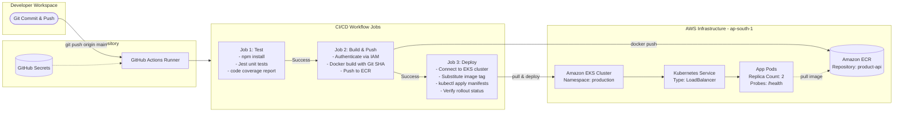

# Task 1: Automated CI/CD Pipeline (GitHub Actions → ECR → Kubernetes)

## Overview
This task implements an automated continuous integration and continuous deployment (CI/CD) pipeline for a containerized Node.js REST API microservice. Every code push to the `main` branch triggers automated testing, container image packaging, vulnerability-conscious artifact publishing to Amazon Elastic Container Registry (ECR), and rolling deployment to an Amazon Elastic Kubernetes Service (EKS) cluster.

---

## Architecture Diagram



---

## Repository & Component Layout

```
task-1/
├── app/
│   ├── src/
│   │   └── index.js             # Express API with /health and CRUD routes
│   ├── tests/
│   │   └── app.test.js          # Jest unit tests covering all endpoints
│   ├── Dockerfile               # Production Docker build (Node 18 Alpine)
│   ├── .dockerignore            # Excludes node_modules, tests, logs
│   ├── .gitignore
│   └── package.json             # App dependencies & test scripts
├── .github/
│   └── workflows/
│       └── ci-cd.yml            # 3-stage GitHub Actions pipeline
├── k8s/
│   ├── deployment.yaml          # K8s Deployment (replicas: 2, probes, limits)
│   └── service.yaml             # K8s Service (LoadBalancer routing to port 3000)
├── screenshots/                 # Submission proof screenshots
│   ├── cicd-01-repo-secrets.png
│   ├── cicd-02-pipeline-running.png
│   ├── cicd-03-tests-passed.png
│   ├── cicd-04-ecr-image.png
│   ├── cicd-05-k8s-deploy.png
│   └── cicd-06-rollout-done.png
└── README.md
```

---

## Application Specifications

The microservice is a production-style Node.js/Express inventory API (`app/`):
- **Endpoints**:
  - `GET /health`: Uptime and health check status (used by Kubernetes liveness and readiness probes).
  - `GET /products`: Retrieves all inventory items.
  - `GET /products/:id`: Fetches a single item by ID.
  - `POST /products`: Validates input and creates a new inventory record.
  - `DELETE /products/:id`: Removes an existing record.
- **Testing**: Jest + Supertest covering validation, 200/201 success paths, and 400/404 error branches.

---

## Implementation Steps

### 1. Local Testing & Verification
Verify that tests pass and coverage artifacts are generated before configuring the pipeline:

```bash
cd task-1/app
npm install
npm test
```

### 2. AWS Pre-requisites
1. **ECR Repository**:
   ```bash
   aws ecr create-repository --repository-name product-api --region ap-south-1
   ```
2. **Kubernetes Namespace**:
   ```bash
   aws eks update-kubeconfig --region ap-south-1 --name <your-eks-cluster-name>
   kubectl create namespace production --dry-run=client -o yaml | kubectl apply -f -
   ```

### 3. GitHub Secrets Configuration
In the GitHub repository, navigate to **Settings** → **Secrets and variables** → **Actions** and add:
- `AWS_ACCESS_KEY_ID`: IAM user access key with ECR and EKS deployment permissions.
- `AWS_SECRET_ACCESS_KEY`: IAM user secret key.
- `EKS_CLUSTER_NAME`: Name of your active Amazon EKS cluster.

### 4. Triggering the CI/CD Pipeline
Commit changes and push to `main`:

```bash
git add task-1/
git commit -m "ci: configure automated pipeline for product-api"
git push origin main
```

### 5. Verification Commands
Confirm the live deployment on your cluster:

```bash
kubectl get deployments -n production
kubectl get pods -n production -o wide
kubectl get svc product-api-svc -n production
kubectl rollout status deployment/product-api -n production
```

---

## Proof of Submission & Screenshots

All execution proofs are preserved in the [`screenshots/`](screenshots/) directory.

### 1. GitHub Repository Secrets
Demonstrates the secure injection of AWS access credentials and cluster configuration into GitHub Actions.

*File: `screenshots/cicd-01-repo-secrets.png`*

---

### 2. Pipeline Execution Overview
Shows the GitHub Actions workflow triggered by a push event to `main`.

*File: `screenshots/cicd-02-pipeline-running.png`*

---

### 3. Automated Unit Testing
Job output showing 100% test pass rate with Jest test assertions and coverage report generation.

*File: `screenshots/cicd-03-tests-passed.png`*

---

### 4. Container Image Pushed to Amazon ECR
AWS Console view of the `product-api` registry displaying the image tagged with both Git commit SHA and `latest`.

*File: `screenshots/cicd-04-ecr-image.png`*

---

### 5. Kubernetes Cluster Deployment
Terminal output verifying that the 2 replicas are running with healthy probes under the `production` namespace.

*File: `screenshots/cicd-05-k8s-deploy.png`*

---

### 6. Successful Rollout Status
Pipeline deployment step confirming `deployment/product-api successfully rolled out`.

*File: `screenshots/cicd-06-rollout-done.png`*
