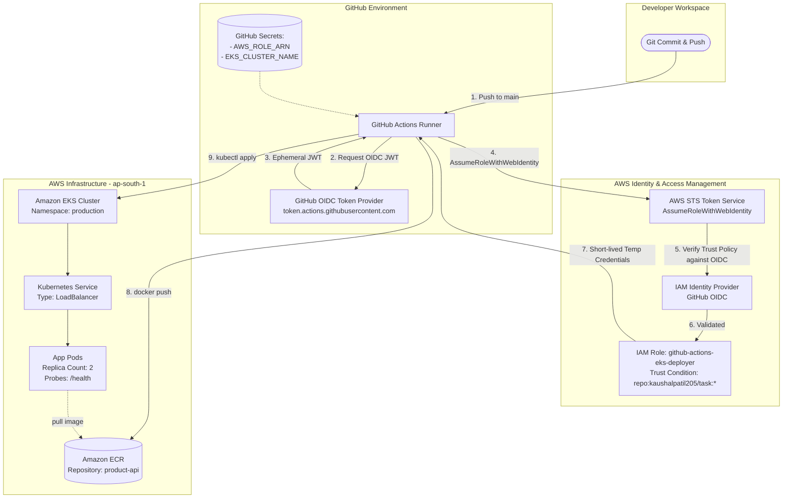

# Task 1: Automated CI/CD Pipeline (GitHub Actions → ECR → Kubernetes via OIDC)

## Overview
This task implements an automated continuous integration and continuous deployment (CI/CD) pipeline for a containerized Node.js REST API microservice. Every code push to the `main` branch triggers automated testing, container image packaging, vulnerability-conscious artifact publishing to Amazon Elastic Container Registry (ECR), and rolling deployment to an Amazon Elastic Kubernetes Service (EKS) cluster.

### Key Security Feature: Zero Long-Lived Credentials (AWS OIDC)
Instead of storing permanent AWS Access Keys in GitHub Secrets, this pipeline implements **OpenID Connect (OIDC)** authentication with AWS Security Token Service (STS). GitHub Actions exchanges an ephemeral JSON Web Token (JWT) directly with AWS IAM via `AssumeRoleWithWebIdentity` to obtain short-lived, automatically expiring credentials.

---

## Architecture Diagram



---

## Repository & Component Layout

```
task-1/
├── app/
│   ├── src/
│   │   └── index.js             # Express API with /health and CRUD routes
│   ├── tests/
│   │   └── app.test.js          # Jest unit tests covering all endpoints
│   ├── Dockerfile               # Production Docker build (Node 18 Alpine)
│   ├── .dockerignore            # Excludes node_modules, tests, logs
│   ├── .gitignore
│   └── package.json             # App dependencies & test scripts
├── iam/
│   └── github-oidc-trust-policy.json # AWS IAM Trust Policy template for OIDC
├── .github/
│   └── workflows/
│       └── ci-cd.yml            # 3-stage GitHub Actions pipeline (OIDC-enabled)
├── k8s/
│   ├── deployment.yaml          # K8s Deployment (replicas: 2, probes, limits)
│   └── service.yaml             # K8s Service (LoadBalancer routing to port 3000)
├── screenshots/                 # Submission proof screenshots
│   ├── cicd-01-repo-secrets.png
│   ├── cicd-02-pipeline-running.png
│   ├── cicd-03-tests-passed.png
│   ├── cicd-04-ecr-image.png
│   ├── cicd-05-k8s-deploy.png
│   └── cicd-06-rollout-done.png
└── README.md
```

---

## Application Specifications

The microservice is a production-style Node.js/Express inventory API (`app/`):
- **Endpoints**:
  - `GET /health`: Uptime and health check status (used by Kubernetes liveness and readiness probes).
  - `GET /products`: Retrieves all inventory items.
  - `GET /products/:id`: Fetches a single item by ID.
  - `POST /products`: Validates input and creates a new inventory record.
  - `DELETE /products/:id`: Removes an existing record.
- **Testing**: Jest + Supertest covering validation, 200/201 success paths, and 400/404 error branches.

---

## Implementation Steps

### 1. Configure AWS OIDC Identity Provider & IAM Role

#### A. Add GitHub OIDC Identity Provider
In AWS Console → **IAM** → **Identity providers** → **Add provider**:
- Provider type: **OpenID Connect**
- Provider URL: `https://token.actions.githubusercontent.com`
- Audience: `sts.amazonaws.com`

*(Or via AWS CLI)*:
```bash
aws iam create-open-id-connect-provider \
  --url https://token.actions.githubusercontent.com \
  --client-id-list sts.amazonaws.com \
  --thumbprint-list 6938fd4d98bab03faadb97b34396831e3780aea1 1c5824a6f504e154699648a3fe4a81ec3230b428
```

#### B. Create IAM Role with Trust Policy
Create an IAM Role (e.g. `github-actions-eks-deployer`) using the trust policy in `task-1/iam/github-oidc-trust-policy.json`:

```json
{
  "Version": "2012-10-17",
  "Statement": [
    {
      "Effect": "Allow",
      "Principal": {
        "Federated": "arn:aws:iam::<YOUR_ACCOUNT_ID>:oidc-provider/token.actions.githubusercontent.com"
      },
      "Action": "sts:AssumeRoleWithWebIdentity",
      "Condition": {
        "StringEquals": {
          "token.actions.githubusercontent.com:aud": "sts.amazonaws.com"
        },
        "StringLike": {
          "token.actions.githubusercontent.com:sub": "repo:kaushalpatil205/task:*"
        }
      }
    }
  ]
}
```

Attach permissions to this role:
- `AmazonEC2ContainerRegistryPowerUser` (for pushing Docker images to ECR)
- An inline policy or cluster role mapping to access EKS (`eks:DescribeCluster`, etc.)

---

### 2. AWS Pre-requisites (ECR & EKS)
1. **ECR Repository**:
   ```bash
   aws ecr create-repository --repository-name product-api --region ap-south-1
   ```
2. **Kubernetes Namespace**:
   ```bash
   aws eks update-kubeconfig --region ap-south-1 --name <your-eks-cluster-name>
   kubectl create namespace production --dry-run=client -o yaml | kubectl apply -f -
   ```

---

### 3. GitHub Secrets Configuration
In the GitHub repository, navigate to **Settings** → **Secrets and variables** → **Actions** and add:
- `AWS_ROLE_ARN`: The ARN of your newly created IAM role (e.g., `arn:aws:iam::<ACCOUNT_ID>:role/github-actions-eks-deployer`).
- `EKS_CLUSTER_NAME`: Name of your active Amazon EKS cluster.

> Notice: No long-lived access keys (`AWS_ACCESS_KEY_ID` or `AWS_SECRET_ACCESS_KEY`) are required!

---

### 4. Triggering the CI/CD Pipeline
Commit changes and push to `main`:

```bash
git add .
git commit -m "ci: configure automated OIDC pipeline for product-api"
git push origin main
```

---

### 5. Verification Commands
Confirm the live deployment on your cluster:

```bash
kubectl get deployments -n production
kubectl get pods -n production -o wide
kubectl get svc product-api-svc -n production
kubectl rollout status deployment/product-api -n production
```

---

## Proof of Submission & Screenshots

All execution proofs are preserved in the [`screenshots/`](screenshots/) directory.

### 1. GitHub Repository Secrets (OIDC Configured)
Demonstrates the secure configuration using `AWS_ROLE_ARN` and `EKS_CLUSTER_NAME` without exposing static credentials.

*File: `screenshots/cicd-01-repo-secrets.png`*

---

### 2. Pipeline Execution Overview
Shows the GitHub Actions workflow triggered by a push event to `main`.

*File: `screenshots/cicd-02-pipeline-running.png`*

---

### 3. Automated Unit Testing
Job output showing 100% test pass rate with Jest test assertions and coverage report generation.

*File: `screenshots/cicd-03-tests-passed.png`*

---

### 4. Container Image Pushed to Amazon ECR
AWS Console view of the `product-api` registry displaying the image tagged with both Git commit SHA and `latest`.

*File: `screenshots/cicd-04-ecr-image.png`*

---

### 5. Kubernetes Cluster Deployment
Terminal output verifying that the 2 replicas are running with healthy probes under the `production` namespace.

*File: `screenshots/cicd-05-k8s-deploy.png`*

---

### 6. Successful Rollout Status
Pipeline deployment step confirming `deployment/product-api successfully rolled out`.

*File: `screenshots/cicd-06-rollout-done.png`*
